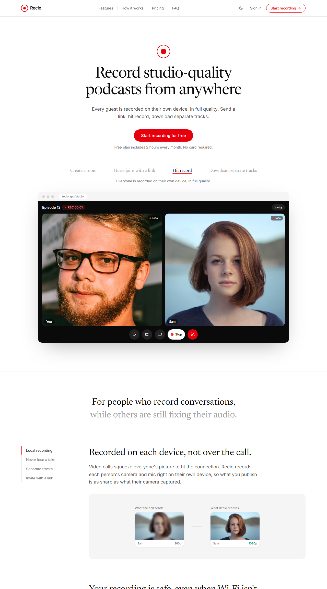
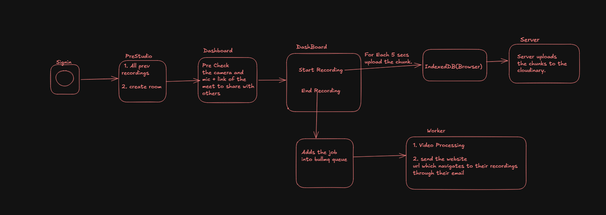

# Recio

**Record studio-quality podcasts from anywhere.** Recio is a remote recording studio in the browser, in the spirit of Riverside: every guest is recorded on their own device in full quality, uploaded in the background while you talk, and merged into separate tracks plus a combined video after the session.



## Features

- **Local recording**: each participant's camera and mic are recorded in the browser with `MediaRecorder`, so quality doesn't depend on the call connection.
- **Never lose a take**: recordings are cut into 5-second chunks, buffered in IndexedDB and uploaded in the background. If the network drops, uploads resume, and the studio won't let you leave until everything is saved.
- **Separate tracks**: download each person's camera and screen share as their own file.
- **Combined video**: everyone side by side; while someone shares their screen, the video switches to the screen with the cameras beside it, then switches back.
- **Live call**: video, audio and screen sharing over WebRTC (LiveKit SFU), invite by link.
- **Accounts**: email/password and Google sign-in, password reset by email.
- **Email when ready**: tracks are merged by a background worker, which emails you a link.

## How a recording flows

1. The browser records each track (camera, screen) in 5-second chunks and stores them in IndexedDB.
2. An upload loop sends chunks to the API (`/api/upload_chunk`), which checks the user is in the room and stores them in Cloudinary with the recorder's start time.
3. When the host stops recording, the API queues a job in BullMQ (Redis).
4. The worker lists each track's chunks in order, joins them with `ffmpeg -c copy`, and builds the combined video. Every track is placed at its real start time, so late joiners and screen shares line up ([composite.ts](backend/Backend/src/selfRecording/composite.ts)).
5. Recordings are saved in Postgres and the host gets an email.



## Tech stack

| Part | Tech |
|---|---|
| Frontend | React, TypeScript, Vite, Tailwind CSS, LiveKit client |
| API | Node.js, Express 5, Prisma, PostgreSQL, JWT, bcrypt |
| Media | LiveKit (WebRTC SFU), MediaRecorder, IndexedDB, ffmpeg, Cloudinary |
| Jobs | BullMQ on Redis, separate worker process |
| Infra | Docker, Docker Compose, nginx |

## Run it locally

You need Docker, plus accounts for [LiveKit Cloud](https://livekit.io) and [Cloudinary](https://cloudinary.com). Google sign-in and email are optional.

```bash
git clone https://github.com/batchu5/recio-studio.git
cd recio-studio
cp backend/Backend/.env.example backend/Backend/.env
cp frontend/frontend/.env.example frontend/frontend/.env
```

Fill in both `.env` files (LiveKit, Cloudinary, `JWT_SECRET`, and optionally Google OAuth and SMTP), then start everything:

```bash
docker compose up --build
```

- Frontend: http://localhost:5173
- API: http://localhost:3000

Compose runs the frontend (nginx), the API, the worker, Postgres and Redis. The database and Redis URLs in `docker-compose.yml` override the ones in `.env`, so local runs never touch a production database. Migrations run when the API starts.

## Tests

The combined-video layout and timing are covered by tests, including one that renders a real video with ffmpeg and checks the frames before, during and after a screen share.

```bash
cd backend/Backend
npm install
npm test
```

## Project structure

```
backend/
  Dockerfile
  Backend/
    prisma/                 schema and migrations
    src/
      index.ts              auth, rooms, LiveKit tokens
      middlewares/          JWT auth
      selfRecording/
        controller.ts       chunk upload, start processing
        merge.ts            chunk listing, ffmpeg merges, uploads
        composite.ts        combined-video layout and timing (tested)
      worker/worker.ts      BullMQ job: merge tracks, save, email
frontend/
  Dockerfile, nginx.conf
  frontend/src/
    pages/                  landing, auth, rooms, studio, tracks
    components/             studio UI, landing sections
    hooks/useRoom.ts        LiveKit room and recording
    utils/uploadworker.ts   IndexedDB buffer and upload loop
docker-compose.yml
```

## Known limitations

- Each person should join a room from one device at a time. LiveKit identities are per user, so a second tab replaces the first.
- Chunks are uploaded through the API to Cloudinary. Uploading straight from the browser with signed uploads would take load off the server.
- Safari's `MediaRecorder` support for WebM is limited; Chrome and Edge work best.
